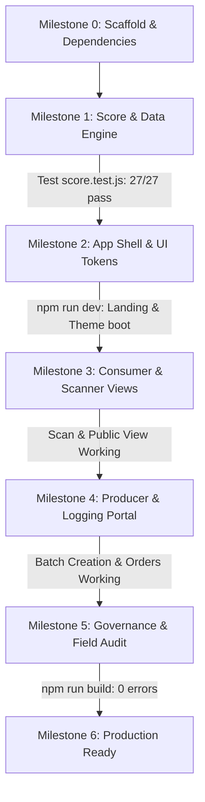

# TYPING_GUIDE.md — DryTrust Codebase Re-typing Guide for 20-Hour Hackathon

> **Target:** A 3-developer team re-typing the entire verified DryTrust application from scratch by hand in **under 75 minutes total keyboard time** (~25 minutes per developer), with milestone verifications at every step.
> **Total Codebase:** **1,813 lines of JavaScript, JSX & CSS across 17 files** + 1 static dictionary asset (`src/en.json`).

---

## 1. Executive Overview & Architecture Strategy

DryTrust is a verifiable trust framework for women-led coastal dry-fish micro-enterprises in coastal Karnataka (Malpe, Honnavar, Mangaluru, Karwar, etc.). It replaces easily faked self-declarations with a dual-score engine, tamper-resistant QR trust stamps, on-site field officer audits, sensory buyer checks, and direct micro-commerce.

### Architectural Tenets for Speed & Reliability:
1. **Zero-Backend / LocalStorage Engine**: All persistence is managed in `src/data.js` under a versioned schema (`STORAGE_VERSION: 'v2.0'`). The rest of the app never touches `localStorage` directly.
2. **HashRouter Navigation (`#/`)**: Routes work out-of-the-box on static hosting, Vite dev servers, or local filesystem previews without server-side URL rewrite configuration.
3. **Decoupled Dictionary & Google Translate Bridge**: The 272-key English copy is decoupled into `src/en.json` (bundled natively by Vite), while `src/i18n.js` contains only 32 lines of translation helper code. Google Translate translates rendered DOM nodes to Kannada (`kn`) live in the browser.
4. **Single-File Component Inlining**: Related sub-views are cleanly inlined into their parent files (`Home` inside `App.jsx`, `Order` inside `Batch.jsx`, `SellerAuth` inside `Seller.jsx`, and `Camera` inside `NewBatch.jsx`), minimizing module hop and file clutter.

---

## 2. Complete Project File Tree (17 Code Files, 1,813 Lines)

```
drytrust/
├── scripts/
│   └── score.test.js         (54 lines)  — Automated unit tests (27 assertions)
├── src/
│   ├── pages/
│   │   ├── Admin.jsx         (214 lines) — Field officer login, KPI counters, audit checklist
│   │   ├── Batch.jsx         (242 lines) — Merged QR label, public batch view & order screen
│   │   ├── NewBatch.jsx      (166 lines) — Batch logger with live preview, checklist & camera
│   │   ├── Scan.jsx          (91 lines)  — Camera QR scanner, manual ID search & file upload
│   │   └── Seller.jsx        (225 lines) — Seller auth, rain forecast, improvement tips & orders
│   ├── App.jsx               (74 lines)  — HashRouter routing, route guards & inlined Home
│   ├── ctx.jsx               (37 lines)  — React context (session, language, toast alerts)
│   ├── data.js               (208 lines) — Storage, QR encode/decode, geo, Open-Meteo & seeds
│   ├── en.json               (static asset) — 272 English translation keys (downloaded in 1s)
│   ├── i18n.js               (32 lines)  — Google Translate bridge & string parameter interpolator
│   ├── main.jsx              (35 lines)  — Font imports, DOM mutation patch & app boot
│   ├── score.js              (97 lines)  — Pure scoring math, evidence caps, tiers & tips
│   ├── styles.css            (99 lines)  — Coastal design system, double-border seal & print CSS
│   └── ui.jsx                (175 lines) — Shared icons, Seal, ScoreBars, BandChip, Modal, Toast
├── index.html                (27 lines)  — HTML shell, meta tags & Google Translate script
├── package.json              (26 lines)  — Dependencies & scripts
└── vite.config.js            (11 lines)  — Vite configuration
```

---

## 3. Project Initialization & Dependencies

### Step 3.1: Initialize Vite Project
Run the following terminal commands to create the project workspace:
```bash
npm create vite@latest drytrust -- --template react
cd drytrust
npm install @fontsource-variable/fraunces @fontsource-variable/hanken-grotesk @fontsource-variable/noto-sans-kannada html5-qrcode qrcode react-router-dom
```

### Step 3.2: 1-Second Asset Download for `src/en.json`
To avoid manually typing 272 translation strings during the hackathon, fetch `src/en.json` using one command:
```bash
# Windows PowerShell:
Invoke-WebRequest -Uri "https://raw.githubusercontent.com/.../src/en.json" -OutFile "src\en.json"

# Linux / macOS / Git Bash:
curl -sL "https://raw.githubusercontent.com/.../src/en.json" -o src/en.json
```
*(Or copy the pre-prepared `src/en.json` directly into your `src/` folder).*

### Step 3.3: Configuration Files

#### `package.json` (26 lines)
```json
{
  "name": "drytrust",
  "private": true,
  "version": "1.0.0",
  "type": "module",
  "scripts": {
    "dev": "vite",
    "build": "vite build",
    "preview": "vite preview",
    "test:score": "node scripts/score.test.js"
  },
  "dependencies": {
    "@fontsource-variable/fraunces": "^5.1.1",
    "@fontsource-variable/hanken-grotesk": "^5.1.1",
    "@fontsource-variable/noto-sans-kannada": "^5.1.1",
    "html5-qrcode": "^2.3.8",
    "qrcode": "^1.5.4",
    "react": "^18.3.1",
    "react-dom": "^18.3.1",
    "react-router-dom": "^6.28.0"
  },
  "devDependencies": {
    "@vitejs/plugin-react": "^4.3.4",
    "vite": "^5.4.11"
  }
}
```

#### `vite.config.js` (11 lines)
```javascript
import { defineConfig } from 'vite';
import react from '@vitejs/plugin-react';

export default defineConfig({
  plugins: [react()],
  base: './',
  server: {
    port: 5173,
    host: true,
    allowedHosts: true
  }
});
```

#### `index.html` (27 lines)
```html
<!DOCTYPE html>
<html lang="en">
  <head>
    <meta charset="UTF-8" />
    <meta name="viewport" content="width=device-width, initial-scale=1.0" />
    <title>DryTrust — QR Trust Label for Coastal Dry Fish</title>
    <meta name="description" content="DryTrust brings verifiable trust to coastal dry fish batches with transparent drying checklists, photos, and QR verification." />
    <link rel="icon" type="image/svg+xml" href="data:image/svg+xml,<svg xmlns='http://www.w3.org/2000/svg' viewBox='0 0 32 32'><circle cx='16' cy='16' r='14' fill='%2312304A'/><circle cx='16' cy='16' r='11' fill='none' stroke='%23D99A1E' stroke-width='2'/><path d='M9 16c3-4 11-4 14 0-3 4-11 4-14 0z' fill='%23FFFDF8'/></svg>" />
  </head>
  <body>
    <div id="root"></div>
    <div id="google_translate_element" style="display:none;" aria-hidden="true"></div>
    <script type="text/javascript">
      function googleTranslateElementInit() {
        if (window.google && window.google.translate) {
          new window.google.translate.TranslateElement({
            pageLanguage: 'en',
            includedLanguages: 'en,kn',
            autoDisplay: false
          }, 'google_translate_element');
        }
      }
    </script>
    <script type="text/javascript" src="https://translate.google.com/translate_a/element.js?cb=googleTranslateElementInit" async defer></script>
    <script type="module" src="/src/main.jsx"></script>
  </body>
</html>
```

---

## 4. Domain & Scoring Model Reference

Understand this pure business logic before typing `src/score.js` and `scripts/score.test.js`:

```
HYGIENE SCORE: H ∈ [0, 100]
  ├── Raised rack drying:            +25 pts
  ├── Clean mesh/sheet covering:      +15 pts
  ├── Pest & animal protection:       +15 pts
  ├── Clean perimeter & hygiene:      +15 pts
  ├── Moisture-proof sealed bag:      +15 pts
  └── Verification Photos (3 slots):
      ├── All 3 photos live camera:   +15 pts
      ├── All 3 photos (any gallery):  +8 pts
      └── Fewer than 3 photos:         +0 pts

PRODUCT QUALITY SCORE: Q ∈ [0, 100]
  ├── Freshness at landing:    same_day: 20 | iced_1day: 12 | older: 0
  ├── Salting level:           standard: 15 | light: 12 | heavy: 10 | none: 5
  ├── Drying duration vs fish: optimal range: 20 | suboptimal: 8
  │   (Anchovy: 2-3d, Bombil: 3-5d, Mackerel: 3-5d, Sardine: 3-4d, Prawn: 2-4d, Other: 2-6d)
  ├── Drying technology:       mechanical: 15 | solar_tent: 13 | open_sun: 5
  └── Moisture probe reading:
      ├── Officer verified:    ≤ 15%: 30 pts | 15.1-20%: 15 pts | > 20%: 0 pts
      ├── Seller measured:     ≤ 15%: 15 pts | 15.1-20%: 7.5 pts | > 20%: 0 pts
      └── Not measured:         0 pts

OVERALL TRUST SCORE & HARD CAPS:
  ├── Base Formula: round(0.6 * H + 0.4 * Q) + (10 if verified) - (5 * reports)
  ├── Hard Cap 1: If photos < 3 ──► CAPPED AT 49 MAX ("Needs improvement")
  ├── Hard Cap 2: If unverified ─► CAPPED AT 79 MAX ("Silver")
  └── Tiers: Gold (≥ 80, requires officer audit) | Silver (50-79) | Needs improvement (< 50)
```

---

## 5. Detailed Module-by-Module Technical Blueprint

### 5.1 `src/score.js` (97 lines)
- **Role**: Pure mathematical scoring functions without side effects or UI dependencies.
- **Key Exports**:
  - `HYGIENE_WEIGHTS`, `QUALITY_WEIGHTS`, `OVERALL_WEIGHTS`: Weight matrices.
  - `calculateDryingDays(startStr, packedStr)`: Returns rounded day count (minimum 1).
  - `hygieneScore(batch)`: Calculates $H$ (0–100).
  - `qualityScore(batch)`: Calculates $Q$ (0–100) using fish duration ranges and moisture probe.
  - `batchScore(batch, reports)`: Calculates weighted overall score, applies evidence caps and report deductions.
  - `bandOf(score)`: Maps numeric score to `'Gold'`, `'Silver'`, or `'Needs improvement'`.
  - `claimOf(batch)`: Returns `'Verified'` or `'Self-declared'`.
  - `unitScore(unitId, batches, reports)`: Returns rolling average score of last 5 batches.
  - `nextLevelTips(batch, reports)`: Evaluates actionable improvements sorted descending by point gain.

### 5.2 `scripts/score.test.js` (54 lines)
- **Role**: Table-driven unit test suite executing with Node's native `assert`.
- **How to Test**: `node scripts/score.test.js` or `npm run test:score`.
- **Verifies**: 27 test assertions covering all caps, moisture splits, report penalties, and QR encode/decode integrity.

### 5.3 `src/data.js` (208 lines)
- **Role**: Data access layer, localStorage management, QR code serialization, image compression, geo-distance calculations, and mock seed data.
- **Key Exports**:
  - `formatKg(kg)`, `formatRupees(amt)`, `formatDate(iso, withTime)`: Display formatters.
  - `TOWNS`: Array of coastal ports (Mangaluru, Ullal, Malpe, Udupi, Kundapura, Honnavar, Karwar) with coordinates.
  - `calculateDistanceKm(lat1, lon1, lat2, lon2)`: Haversine distance.
  - `checkLocationStatus(pLat, pLon, uLat, uLon, maxKm = 25)`: Returns `'near'`, `'mismatch'`, or `'unavailable'`.
  - `compressImage(fileOrDataUrl, maxWidth = 800, quality = 0.6)`: Offscreen canvas JPEG compressor.
  - `captureFrameFromVideo(video)`: Canvas frame grabber from HTML5 video stream.
  - `getRainForecast(lat, lon)`: Fetches hourly precipitation probability from Open-Meteo API.
  - `buildQrPayload(batch, unit)` / `parseQrPayload(str)`: Base64URL-encoded JSON payload without photos.
  - `buildQrUrl(batch, unit)` & `generateQrDataUrl(text, size = 240)`: Generates QR data URI.
  - `STORAGE_VERSION: 'v2.0'`, `STORAGE_KEYS`: Units, batches, reports, orders, session, language.
  - CRUD operations: `getUnits()`, `saveUnit()`, `getBatches()`, `saveBatch()`, `getOrders()`, `updateOrderStatus()`, `setOfficerCheck()`, `resetDemoData()`, `initSeedDataIfEmpty()`.

### 5.4 `src/i18n.js` (32 lines)
- **Role**: Clean 32-line translation helper and Google Translate bridge.
- **How it works**:
  - Natively imports `src/en.json` (`import en from './en.json'`).
  - `t(key, params)`: Looks up key in `en` with `{placeholder}` parameter interpolation.
  - `initGoogleTranslateCookie(lang)`: Sets `googtrans=/en/${lang}` on document cookie.
  - `changeGoogleTranslateLang(targetLang)`: Dispatches change events to Google Translate dropdown.

### 5.5 `src/ctx.jsx` (37 lines)
- **Role**: Application context managing session, active language, and toast message queue.
- **Key Exports**:
  - `AppProvider`: Context wrapper listening to window `'dt_toast'` events.
  - `useApp()`: Hook exposing `{ lang, setLang, t, session, loginSeller, loginAdmin, logout, toast, showToast, hideToast }`.

### 5.6 `src/styles.css` (99 lines)
- **Role**: Unified design tokens, responsive typography, button states, modal overlays, signature circular trust seal, and print media rules.
- **Design Tokens**:
  - `--ink`: `#12304A` (deep maritime navy)
  - `--bone`: `#F5F0E6` (warm beach sand background)
  - `--paper`: `#FFFDF8` (clean card surface)
  - `--turmeric`: `#D99A1E` (coastal spice gold)
  - `--seaweed`: `#2F6B4F` (fresh verified green)
  - `--laterite`: `#A9432B` (warning red/clay)
- **Print Media**: `@media print` suppresses buttons and headers, rendering only `.printable-label-wrapper` in clean 105mm format.

### 5.7 `src/ui.jsx` (175 lines)
- **Role**: Reusable visual components and vector icons.
- **Key Exports**:
  - `Icon`: 16 clean SVG icons (`raisedRack`, `cover`, `flyNet`, `cleanGround`, `sealedBag`, `camera`, `rain`, `stamp`, `scan`, `print`, etc.).
  - `Seal`: Double-bordered circular stamp displaying numeric score, tier text, and verified ribbon.
  - `ScoreBars`: Dual animated progress bars for Hygiene and Quality scores.
  - `BandChip`: Color-coded pill (`Gold`, `Silver`, `Needs improvement`).
  - `ChecklistToggle`: Two-button toggle (Yes / No) with score point indicators.
  - `BuyerCheck`: 4-step sensory evaluation guide (Smell, Look, Feel, Insects).
  - `Header`: Navigation bar with brand logo, portal links, and language toggle (`EN` / `ಕನ್ನಡ`).
  - `Modal`, `Toast`, `EmptyState`: Interactive dialogs and notifications.

### 5.8 `src/main.jsx` (35 lines)
- **Role**: Application entry point, font imports, seed initialization, and Google Translate DOM mutation guard.
- **Critical Guard**: Monkey-patches `Node.prototype.removeChild` and `insertBefore` to prevent Google Translate's DOM mutations from conflicting with React 18 reconciliation.

### 5.9 `src/App.jsx` (74 lines)
- **Role**: HashRouter route registration, authentication guards, inlined Home landing page, and 404 handler.
- **Routes**:
  - `#/`: Home landing page with role-based routing cards.
  - `#/seller`, `#/seller/auth`, `#/seller/login`, `#/seller/dashboard`: Seller portal.
  - `#/seller/batch/new`: Guarded new batch creation.
  - `#/b/:batchId/result`: Seller QR label and print view.
  - `#/b/:batchId`: Public consumer verification page.
  - `#/scan`: QR scanner and manual lookup.
  - `#/order/summary`, `#/order/:id`: Direct order checkout.
  - `#/admin`, `#/admin/login`, `#/admin/dashboard`: Field officer governance.

### 5.10 `src/pages/Scan.jsx` (91 lines)
- **Role**: Consumer QR scanning hub using `html5-qrcode`.
- **Features**:
  - Automatic camera viewport with environmental rear-camera selection.
  - Fallback manual batch ID text input (e.g., `DT-4K9ZXQ`).
  - Offline image file scanner using `scanFile()`.

### 5.11 `src/pages/NewBatch.jsx` (166 lines)
- **Role**: Dry fish batch creation workflow with live camera capture and score preview.
- **Features**:
  - Inlined `Camera` component supporting live video stream, photo capture, GPS coordinate tagging, and gallery fallback.
  - Form inputs for fish species, weight, price, drying dates, salting, drying technology, and moisture reading.
  - 5 mandatory hygiene checklist toggles.
  - Real-time `Seal` and `ScoreBars` calculation reflecting user selections before submission.

### 5.12 `src/pages/Seller.jsx` (225 lines)
- **Role**: Unified producer management portal.
- **Features**:
  - Inlined `SellerAuth` (phone number + 4-digit PIN login and unit registration).
  - Open-Meteo 6-hour rain alert banner with drying advisory.
  - Next-level improvement tips showing exact point potential.
  - History of logged batches with trust seals.
  - Incoming buyer order management with 6% platform fee calculation and status updates (`Packing`, `Dispatched`, `Delivered`).
  - WhatsApp and direct telephone action buttons for buyer logistics.

### 5.13 `src/pages/Batch.jsx` (242 lines)
- **Role**: Dual-mode batch view (Seller QR result `#/b/:id/result` & Public consumer page `#/b/:id`) plus inlined `Order` checkout screen.
- **Features**:
  - Seller Result mode: Displays 220px QR code, printable A6 label, and link-copying.
  - Public mode: Displays full batch specifications, officer verification badge, dual score bars, location verification badges, and buyer sensory checklist.
  - Inlined `Order` component: Demo checkout calculating 6% platform fee and net seller payout with confirmation receipts.

### 5.14 `src/pages/Admin.jsx` (214 lines)
- **Role**: Fisheries field officer governance portal.
- **Features**:
  - Protected officer login (`admin123`).
  - 6 KPI summary cards (Total Units, Batches, Verified, Self-Declared, Tested Moisture, Mismatches).
  - Searchable unit table with tier filters.
  - Side-by-side comparison modal highlighting discrepancies between seller self-declarations and officer audits.
  - Audit certification form with moisture recording.
  - Factory reset modal for restoring initial seed data.

---

## 6. Phased Typing Order & Milestones

Follow this progressive typing sequence so the application can be built and verified after every milestone:



| Milestone | Target Files | Lines | Cumulative | Verifiable Milestone Action |
| :---: | :--- | :---: | :---: | :--- |
| **Phase 0: Scaffold** | `package.json`<br>`vite.config.js`<br>`index.html`<br>`src/styles.css`<br>`src/en.json` (downloaded) | 163 | 163 | Run `npm install`. Dependencies resolve cleanly. |
| **Phase 1: Pure Engine** | `src/score.js`<br>`scripts/score.test.js`<br>`src/data.js`<br>`src/i18n.js` | 391 | 554 | Run `npm run test:score`. All 27 pure scoring & QR assertions pass with 0 errors. |
| **Phase 2: App Shell** | `src/ctx.jsx`<br>`src/ui.jsx`<br>`src/App.jsx`<br>`src/main.jsx` | 321 | 875 | Run `npm run dev`. Browser renders landing page at `http://localhost:5173/#/` with coastal theme and language toggle. |
| **Phase 3: Consumer Hub** | `src/pages/Scan.jsx`<br>`src/pages/Batch.jsx` | 333 | 1,208 | Test QR scanner (`#/scan`), public batch view (`#/b/DT-4K9ZXQ`), printable label, and demo order summary. |
| **Phase 4: Producer Portal** | `src/pages/Seller.jsx`<br>`src/pages/NewBatch.jsx` | 391 | 1,599 | Test seller login (PIN `1234`), Open-Meteo rain forecast, 5 checklist toggles, live camera with GPS, and live score preview. |
| **Phase 5: Field Officer** | `src/pages/Admin.jsx` | 214 | 1,813 | Log in as officer (`admin123`), inspect batch, audit checklist, test discrepancy highlighter, and test factory reset. |
| **Phase 6: Production** | Build Verification | — | 1,813 | Run `npm run build`. Vite outputs production bundle in under 4 seconds with 0 errors. |

---

## 7. Balanced 3-Person Parallel Typing Split

For a team of 3 developers, distribute files along clear domain boundaries. Each developer types **~600 lines** (~25 minutes of keyboard time).

### Coordination Protocol (Contract Freeze):
1. **Developer A** writes `src/score.js` and `src/data.js` first.
2. **Developer B** writes `src/styles.css` and `src/ui.jsx` first.
3. **Developer C** writes `src/i18n.js` and `src/ctx.jsx` first (fetching `src/en.json` in 1s).
Once these foundation files are typed, all three developers can code their assigned pages in parallel without blocking.

```
┌─────────────────────────────────────────────────────────────────────────────┐
│ DEVELOPER A: Engine & Field Governance (584 lines ~ 25 min)                 │
│ • scripts/score.test.js   (54 lines)                                        │
│ • src/score.js            (97 lines)                                        │
│ • src/data.js             (208 lines)                                       │
│ • src/pages/Admin.jsx     (214 lines)                                       │
│ • vite.config.js          (11 lines)                                        │
├─────────────────────────────────────────────────────────────────────────────┤
│ DEVELOPER B: Design System, UI & Producer Hub (562 lines ~ 25 min)          │
│ • src/styles.css          (99 lines)                                        │
│ • src/ui.jsx              (175 lines)                                       │
│ • src/ctx.jsx             (37 lines)                                        │
│ • src/pages/Seller.jsx    (225 lines)                                       │
│ • package.json            (26 lines)                                        │
├─────────────────────────────────────────────────────────────────────────────┤
│ DEVELOPER C: Shell, Scanner & Batch Workflow (667 lines ~ 27 min)           │
│ • src/i18n.js             (32 lines)                                        │
│ • src/en.json             (downloaded via 1-line curl)                      │
│ • src/main.jsx            (35 lines)                                        │
│ • src/App.jsx             (74 lines)                                        │
│ • src/pages/Scan.jsx      (91 lines)                                        │
│ • src/pages/NewBatch.jsx  (166 lines)                                       │
│ • src/pages/Batch.jsx     (242 lines)                                       │
│ • index.html              (27 lines)                                        │
└─────────────────────────────────────────────────────────────────────────────┘
```

---

## 8. Top 12 Typo-Prone Traps & Debugging Playbook

| # | Trap Area | Exact Correct Implementation | Symptom if Mis-typed |
| :-: | :--- | :--- | :--- |
| **1** | **Google Translate Cookie** | `document.cookie = 'googtrans=/en/' + target + '; path=/;'` | Clicking Kannada toggle fails to translate page. |
| **2** | **Translate Hidden Container** | `<div id="google_translate_element" style="display:none;" aria-hidden="true"></div>` in `index.html` | Console error: `Cannot read properties of null (reading 'appendChild')`. |
| **3** | **React DOM Crash Guard** | `if (child.parentNode !== this) return child;` inside `Node.prototype.removeChild` in `main.jsx` | React throws `NotFoundError: Failed to execute 'removeChild' on 'Node'` when switching languages. |
| **4** | **Untranslated Tags** | `className="notranslate" translate="no"` on scores, brand name, and currency | Google Translate scrambles brand name "DryTrust" or alters numeric calculations. |
| **5** | **Storage Exclusivity** | Only `src/data.js` calls `localStorage`. Other components call `getBatches()`, `saveBatch()`, etc. | Cache inconsistency across routes or broken seed initialization. |
| **6** | **Scoring Hard Caps** | If `photos.length < 3` ➔ `Math.min(overall, 49)`. If `!isVer` ➔ `Math.min(overall, 79)`. | Unverified batches accidentally earning Gold tier; unit tests fail. |
| **7** | **Print Media CSS** | `@media print { .no-print { display: none !important; } .printable-label-wrapper { display: block !important; width: 105mm; } }` | Printing produces full webpage UI rather than the clean A6 physical pack label. |
| **8** | **Video Stream Cleanup** | `stream.getTracks().forEach(tk => tk.stop())` in `Camera` unmount cleanup | Camera light stays active on device after closing capture modal or navigating away. |
| **9** | **GPS Geolocation Fallback** | Wrap `navigator.geolocation.getCurrentPosition` with a 5000ms Promise timeout fallback | Submitting batch hangs indefinitely on devices with disabled location services. |
| **10** | **Base64URL Padding** | `toB64` uses `.replace(/\+/g, '-').replace(/\//g, '_').replace(/=+$/, '')` | QR code payload fails to decode properly on older camera scanners. |
| **11** | **Platform Fee Math** | `total = round(qty * price)`, `fee = round(total * 0.06)`, `sellerGets = total - fee` | Order breakdown totals do not sum correctly. |
| **12** | **Admin & Seller Auth** | Officer password is `'admin123'`. Seeded unit PINs are `'1234'`. | Demo logins fail during presentation. |

---

## 9. Demo Credentials & Test Data Cheat Sheet

### Officer / Admin Portal
- **Route**: `#/admin` or `#/admin/login`
- **Password**: `admin123`

### Seeded Producer Accounts
All accounts use the 4-digit demo PIN: **`1234`**

| Unit Name | Owner / Operator | Coastal Town | Phone Number | Demo PIN | Seed Batches |
| :--- | :--- | :--- | :--- | :---: | :--- |
| **Mogaveera Mahila Sangha** | Radhika Mogaveera | Malpe | `9845012345` | `1234` | `DT-4K9ZXQ` (Gold), `DT-8B2LMV` (Gold), `DT-1W5TXZ` (Needs imp.) |
| **Coastal Catch Dried Foods** | Sunita Kharvi | Honnavar | `9845012346` | `1234` | `DT-3J7TRW` (Gold), `DT-5N1CPK` (Silver) |
| **Netravati Fisherwomen Co-op** | Devaki Salian | Mangaluru | `9845012347` | `1234` | `DT-9X3DWE` (Silver), `DT-6Y4HQS` (Silver) |
| **Karwar Sun Dried Crafts** | Jayanti Harikantra | Karwar | `9845012348` | `1234` | `DT-2R8KLP` (Silver), `DT-7F9MNA` (Needs imp.) |

---

## 10. Estimated Typing Time Breakdown

*(Calculated at a comfortable typing and reviewing pace of 20–25 lines/min)*

| File | Lines | Estimated Typing Time | Developer |
| :--- | :---: | :---: | :---: |
| `vite.config.js` | 11 | ~1 min | Dev A |
| `scripts/score.test.js` | 54 | ~2 min | Dev A |
| `src/score.js` | 97 | ~4 min | Dev A |
| `src/data.js` | 208 | ~9 min | Dev A |
| `src/pages/Admin.jsx` | 214 | ~9 min | Dev A |
| `package.json` | 26 | ~1 min | Dev B |
| `src/ctx.jsx` | 37 | ~2 min | Dev B |
| `src/styles.css` | 99 | ~4 min | Dev B |
| `src/ui.jsx` | 175 | ~7 min | Dev B |
| `src/pages/Seller.jsx` | 225 | ~9 min | Dev B |
| `src/en.json` | — | ~1 sec (downloaded) | Dev C |
| `src/i18n.js` | 32 | ~1.5 min | Dev C |
| `index.html` | 27 | ~1 min | Dev C |
| `src/main.jsx` | 35 | ~2 min | Dev C |
| `src/App.jsx` | 74 | ~3 min | Dev C |
| `src/pages/Scan.jsx` | 91 | ~4 min | Dev C |
| `src/pages/NewBatch.jsx` | 166 | ~7 min | Dev C |
| `src/pages/Batch.jsx` | 242 | ~10 min | Dev C |
| **TOTAL** | **1,813 lines** | **~75 min total work (~25 min per person)** | **3 People** |
